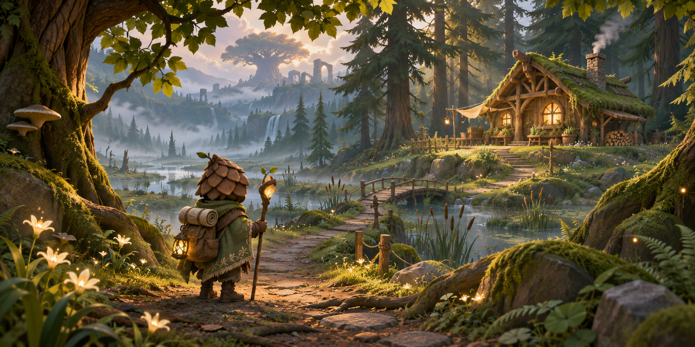

# Lumenwood 总概念图 v1



- **用途**：整体氛围与空间层次讨论稿，非游戏截图、地图、资产参考正交图或最终验收效果。
- **画面解读**：林径与暖光木屋暗示林间营地，湿地及远处古树暗示后续区域；区域实际连接与尺度尚未确定。背影角色仅作为尺度与情绪提示，造型以已确认的角色参考为准。
- **边界**：图中手杖、背包、桥、瀑布、遗迹等是生成时出现的构图细节，未作为功能、资产或场景范围确认；光照和细节不代表实时性能承诺。
- **来源**：2026-11-10 使用 ChatGPT 内置 imagegen 根据项目美术方向生成一张，未使用 Meshy；成本与使用权以所用服务实际条款及账户情况为准，尚未核实。仅供设计讨论，正式 3D 资产仍遵循 Meshy 流程。
- **生成提示词**：

```text
Use case: stylized-concept. Create one wide cinematic master concept artwork for Lumenwood, an independent third-person magical forest exploration game. A small pinecone-hooded woodland traveler seen from behind stands on a winding navigable woodland path, looking toward a cozy handcrafted wooden cabin in a clearing, with layered conifers, mossy roots, subtle luminous flowers and scattered fireflies. Suggest a cool misty wetland and distant ancient-tree highland as atmospheric hints in the background, not a literal map. Premium stylized 3D indie game aesthetic, organic readable silhouettes, tactile wood and moss, restrained detail, peaceful curious and mysterious; moss and deep forest green, honey brown, cream, soft amber gold and restrained twilight blue, warm light through canopy, soft mist and cinematic depth. Clear spatial scale and believable paths. No text, labels, UI, watermark, hyperrealism, neon, excessive bloom or childish toy appearance. This is a visual mood and composition proposal, not an asset specification.
```
